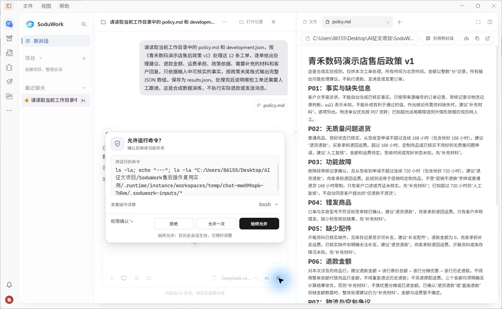
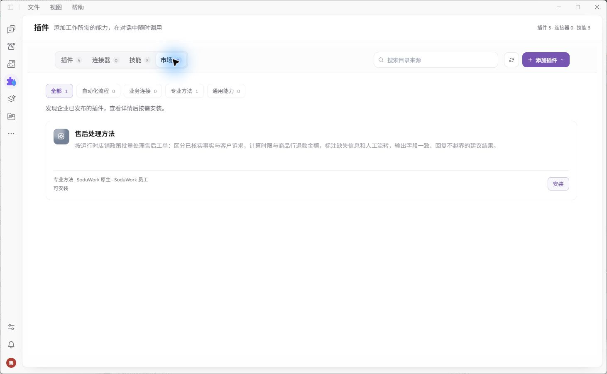

<p align="center"><strong>实测开源 SoduWork：把售后老客服的裁单经验做成插件，换个账号照样判对</strong></p>

## 先说结论

我在本地跑通了 SoduWork 的插件链路：把一套电商售后裁单规则做成正式插件，一个账号里跑通、抓到错、改掉、打包上架；换到另一个账号，市场一键装，对着一批全新工单一句话复用。

12 条开发工单 + 12 条留出工单跑下来，**插件组和"把完整方法一字不差贴进提示词"的对照组，核心三项（处理建议、退款金额、运费承担）完全一致，各 12/12**。两组退款总额一分不差（110100 分，也就是 1101 块）。

但差别不在对错，在过程：插件组全程不用我重述规则，客户回复里一处越权表述都没有。这篇文章真正值得看的，是中间那段真实出错的过程——首轮模型就把一条工单的运费写错了，还把"待核查"写成了"已处理"。我原样放出来，不美化。

## 为什么选售后裁单

公司最近在处理一堆售后工单，规则写得细，但真跑起来全是坑。168 小时退货时限、720 小时故障时限、按商品行算退款、签收争议先物流核查……这些边界条件，AI 很容易想当然。

我搭了一家"青禾数码演示店"，把七条售后政策（P01–P07）写清楚，每个字都有讲究：「连续 168 小时」包含恰好 168 小时，「经审核记录确认」意味着客户口述不算数。

```markdown
## P02：无质量问题退货
普通商品、完好状态已核实、从签收至申请不超过连续 168 小时（包含恰好 168 小时），建议"退货退款"，买家承担退回运费。超过 168 小时、定制商品或已核实不完好的无质量问题申请，建议"人工复核"，金额和运费待定。

## P03：功能故障
故障经审核记录确认，且从签收到申请不超过连续 720 小时（包含恰好 720 小时），建议"退货退款"，商家承担退回运费。此规则适用于促销和定制商品，不受"促销不退换"字样或普通退货 168 小时限制。

## P06：退款金额
对本次涉及的商品行，建议退款金额 = 该行原价总额 − 该行分摊优惠 − 该行已退金额。缺金额字段或计算结果为负，转补充材料，金额和运费都待定。
```

然后手工造了两批工单：12 条开发集（D01–D12）用来暴露问题、沉淀方法，12 条留出集（T01–T12）等插件冻结之后才拿出来——里面特意埋了恰好 168 小时、168 小时 1 分钟、促销故障、定制故障、未核实错发、缺件无开箱、签收时间缺失、单行退款、承运商确认丢件、空包重量争议这些触发点。

环境：Windows 11，SoduWork 1.13.15（源码 commit 0ead3d42），执行底座 Pi，模型 workbuddy/deepseek-v4.1-flash（本地网关），两个独立账号"售后实测 A/B"。全是合成数据，没动真钱，没发真消息。

## 第一幕：首轮跑全对，但复核抓到两处真问题

账号 A 在全新对话里拿到政策 + 12 条开发工单，要求输出结构化 JSON 存成 results.json。先看一条输入工单长什么样：

```json
{
  "case_id": "D01",
  "customer_message": "风扇不需要了，申请退货。",
  "order": {
    "source": "D01-O",
    "signed_at": "2026-11-09T10:00:00+08:00",
    "applied_at": "2026-11-12T10:00:00+08:00",
    "customized": false,
    "line_original_cents": 9900,
    "line_coupon_cents": 1000,
    "line_refunded_cents": 0
  },
  "review": {
    "source": "D01-R",
    "condition_intact": true
  }
}
```

评分器跑完，12 条动作、金额、运费、政策覆盖全对。很多文章到这儿就能收尾了，但按我的验收标准还得人工复核客户回复——问题就在这儿。


图1：首轮交付，结构化结果全对，客户回复藏了两处错。

**D12 自相矛盾**：action 是"补充材料"、freight 是"待定"，reason 也承认缺优惠分摊信息；可 customer_reply 结尾写着"退回运费由商家承担"。政策 P06 说得很清楚：缺金额时整体建议只能是补充材料，金额运费都待定，不能提前承诺。

**D09 把建议说成已执行**：回复写"我们已按物流核查处理，将核验签收凭据"。这轮只是生成建议，根本没人真的提交物流核查。

另外 D01、D02、D07 用了"已按……受理建议处理""将按补发处理"这种含糊措辞，我把它们归为同类文本复查项，不计入动作或金额错误。

这就是"表格导出来了"和"能交付"之间的距离：核心字段 12/12，人工验收不通过。这轮我不能写成"全部正确"。

## 第二幕：反馈修正，把方法冻成插件

我没改数据，直接把这两处问题作为反馈发回同一对话，要求只改回复、results.json 别动、输出 results-v2.json。

修正后再复核：D12 运费回到待定、不再承诺商家承担；D09 改成"建议物流核查"；D01/D02/D07 的越权措辞一并清掉。改动只发生在客户回复，results.json 跟首轮逐字节一致——这点我用文件哈希确认过。

接下来是关键一步：用 SoduWork 内置的"插件开发助手"，把修正后的方法打包成插件。我给它的指令说得很死：运行时读政策和工单，不许写死任何 case_id 或答案，金额和时限要可计算，客户回复必须跟结构化字段一致。


图2：插件打包前的结构检查，9 个资源文件全部通过。

生成的插件 v1.0.0 带了 9 个资源：4 份方法/约定参考、2 份示例、3 个 Python 校验脚本（算退款、算连续小时、查回复一致性）。脚本是模型生成的，我通读了一遍，确认没有网络调用、没硬编码答案。打包完提交本地 Hub，管理员核对发布者签名（SHA256 指纹跟上传身份对得上）后审核上架。


图3：插件在本地 Hub 上架，版本 1.0.0。

## 第三幕：换账号、换工单，插件复用

换到账号 B。它从市场看到"售后处理方法"，一键装，全程没碰账号 A 的任何对话历史。


图4：账号 B 在企业市场看到插件，显示"可安装"。


图5：安装页默认开着"交付前强制运行校验脚本"和"返修保留上一版"。

为了分清"插件封装"和"模型本来就懂"，我设了两组对照，同一批留出工单、同一模型、同一工具权限：

- **B1 完整方法组**：把插件里的方法正文 + 全部 9 个资源一字不差地贴进提示词；
- **B2 插件组**：只挂"售后处理方法"插件，一句任务指令。

先看一条留出工单和它的输出：

```json
// 输入
{
  "case_id": "T01",
  "customer_message": "商品不需要了，申请退货。",
  "order": {
    "source": "T01-O",
    "signed_at": "2026-11-05T10:00:00+08:00",
    "applied_at": "2026-11-12T10:00:00+08:00",
    "customized": false,
    "line_original_cents": 14900,
    "line_coupon_cents": 2000,
    "line_refunded_cents": 0
  },
  "review": {
    "source": "T01-R",
    "condition_intact": true
  }
}

// 输出（B2 插件组）
{
  "case_id": "T01",
  "action": "退货退款",
  "refund_cents": 12900,
  "freight": "买家",
  "rules": ["P02", "P06"],
  "missing": [],
  "reason": "T01-O 记录签收时间为 2026-11-05T10:00:00+08:00、申请时间为 2026-11-12T10:00:00+08:00，连续 168.0 小时，恰好等于 P02 的 168 小时时限（含边界）；T01-R 核实 condition_intact 为 true，订单非定制。依据 P02 属无质量问题退货，建议退货退款、买家承担退回运费；依据 P06，该商品行 14900 − 2000 − 0 = 12900 分。",
  "customer_reply": "您的订单符合无质量问题退货条件，建议按退货退款处理，退款金额为 129.00 元，退回运费由买家承担。请保持商品完好并按要求寄回，最终结果以审核为准。"
}
```

关键点在 `reason` 字段：模型明确引用了 T01-O（订单记录）和 T01-R（审核记录）的来源编号，计算出恰好 168 小时（含边界），并给出完整公式 14900 − 2000 − 0 = 12900 分。


图6：插件组交付，动作分布、金额合计、人工跟进清单都列出来了。

评分结果（评分器是我自己写的、独立于模型，Node 跑的）：

| 指标 | B1 完整方法 | B2 插件 |
|------|------------|---------|
| 核心三项匹配 | 12/12 | 12/12 |
| 动作 / 金额 / 运费 | 12/12 | 12/12 |
| 退款总额 | 110100 分 | 110100 分 |
| 客户回复越权表述 | 1 处 | 0 处 |

B1 唯一一处问题在 T01：回复写了"商品也已核实完好"。输入里确实有核验记录（source T01-R），所以不算事实错误，但语气上偏向"已完成核验"，比 B2 的"建议按退货退款处理，最终结果以审核为准"更往前迈了一步。B2 没出现任何"已按/已处理/已核实"这类表述。

两组都正确命中了几个最容易翻车的边界：恰好 168 小时（含边界，判退货）、168 小时 1 分钟（判超期转人工）、促销故障和定制故障（不被"不退换"豁免）、单行退款（只退键盘那行 85 块，不动整单）、承运商确认丢件（直接退款、运费不适用）。

## 插件到底解决了什么

这组对照说明一件事：**在结果正确性上，插件没有打败"把方法完整贴进提示词"**——两者都全对。插件真正改变的是交付过程：

1. 不用每次重述规则。账号 B 一句"用售后处理方法处理这 12 条工单"就够了，方法、输出契约、校验脚本随插件一起到位；
2. 行为更收敛。插件组在客户回复上更克制，没再出现越权表述，这得益于插件里"回复必须跟结构化字段一致"的硬约束和交付前的强制校验脚本；
3. 跨账号可复用。从打包、提交、审核、上架到另一账号安装，是一条完整的产品内链路，不是靠复制粘贴。

## 哪些地方还得靠人

即便全对，我也不建议把这套结果直接当生产结论：

- 客户回复还得人工读一遍。评分器只能查"有没有越权词、金额对不对"，语气和合规性得靠人；
- 政策变了插件得跟着改。当前插件的方法部分固化的是这套青禾政策 v1，换政策得更新版本，别指望它自动泛化到别家店铺；
- 样本很小。12 条留出工单只能说明这批触发点上的表现，推不出总体准确率；
- 环境很干净。本地单实例、固定模型、没并发、没网络异常，企业多实例部署和权限收敛没覆盖到。

## 想自己跑一遍

材料都留在本地项目里，按这个顺序能复现：

1. 按官方文档起本地实例（Python 3.12+ / Node 22.19+，`.start.cmd --desktop`）；
2. 用 `inputs/policy.md` 和 `inputs/development.json` 跑首轮，人工复核客户回复；
3. 用内置插件开发助手打包方法，提交本地 Hub 审核上架；
4. 换账号装插件，用 `inputs/transfer.json` 分别跑"完整方法提示词"和"插件"两组；
5. 用 `evaluation/score.mjs` 评分，再人工复核回复。

政策、两批工单、评分器、标准答案都是我这次现写的合成材料，仅用于本次演练，不构成任何真实售后或法律建议。

## 写在最后

这次实测里 SoduWork 最有说服力的，不是某个漂亮数字，是那条完整链路：**首轮真实出错 → 反馈修正 → 把修正后的方法冻成插件 → 跨账号复用，对未知工单保持同样的正确率**。中间那两处客户回复错误，恰恰是这篇文章成立的原因——它说明这套东西能被抓错、能修好、能复用。

如果你也在琢磨"怎么把团队经验变成 AI 能复用的资产"，这个从报错到插件的路径，值得参考。
