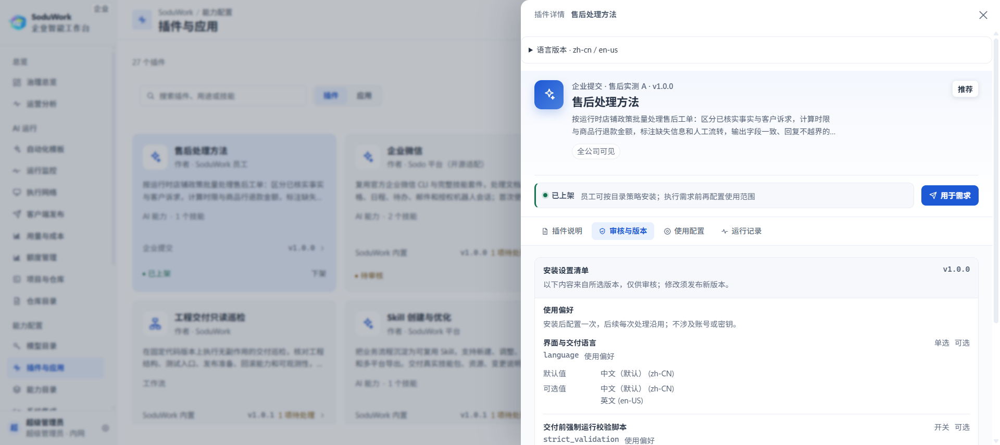
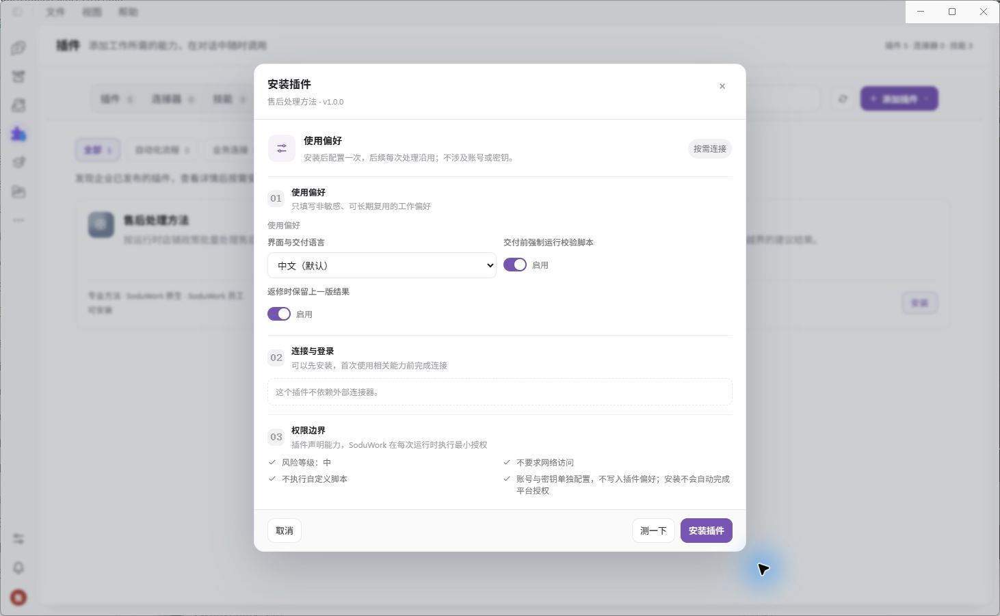
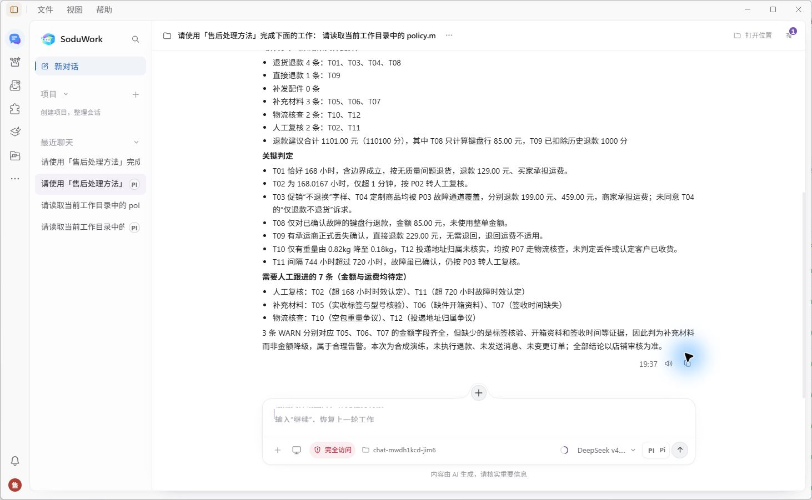

<p align="center"><strong>实测开源 SoduWork：把售后老客服的裁单经验做成插件，换个账号照样判对</strong></p>

## 一、写在前面

售后裁单这事，每个电商团队都有自己的一套规矩：普通退货几天内有效、故障件放宽到几天、退款怎么扣优惠券、运费谁承担。这些规矩写在文档里，老员工看一眼就懂，新人得培训两周。更麻烦的是，规矩里全是边界：168 小时包不包含恰好 168 小时？促销商品故障了能不能退？这些问题，每次都得翻政策原文。

我看到 SoduWork 这个项目，它给的解法是把做法沉淀成插件：不是每次把政策全文甩给 AI 让它自由发挥，而是把步骤、规则、校验脚本打包，谁用谁装。这次实测只验证一条主线：**一套售后裁单方法，在一个账号里跑通、抓到错、改掉、打包成插件之后，换个账号一句话复用，能不能保持同样的正确率。**

结论摘要：12 条开发工单 + 12 条留出工单跑下来，**插件组和"把完整方法一字不差贴进提示词"的对照组，核心三项（处理建议、退款金额、运费承担）完全一致，各 12/12**，两组退款总额一分不差（110100 分，即 1101 元）。但差别在过程：插件组全程不用重述规则，客户回复里一处越权表述都没有；对照组出现 1 处语气超前。首轮真实出错——模型把"补充材料"工单的运费写成了"商家承担"、把"待核查"写成了"已处理"——我原样记录，不美化。

适合：有成文规则、错一次就出事的重复性售后场景。不适合：规则天天变、没有明确对错标准的场景。

评测环境：

| 项 | 值 |
|------|------|
| 日期 | 2026-11-12 |
| 设备 / 系统 | Windows 11 |
| 部署方式 | 源码本地运行（start.cmd --desktop） |
| SoduWork 版本 | 1.13.15（commit 0ead3d42） |
| 底座 / 模型 | Pi + workbuddy/deepseek-v4.1-flash（本地网关） |
| 账号 | 售后实测 A（主）、售后实测 B（模拟新人） |

## 二、30 秒了解 SoduWork

SoduWork 是一个开源的企业 AI 协作工作台（源码：github.com/mdiri-ai/SoduWork，MIT 协议）。简单说就是：人和 AI 在同一个需求池里接活、交接、验收。几个核心概念：

- **插件**：把一项工作的方法、步骤、校验脚本、输入表单打包成有版本号的资产，提交审核后发布给团队，按权限安装使用；
- **关卡**：插件可以带确定性校验脚本（比如金额重算、时限检查），交付前强制运行，不通过就返修；
- **需求池**：任务不是一次性的聊天记录，而是可验收、可留痕、可复用的工作单元。

有一点要提：插件不省 token。核查本身要花 token，买的是结论正确，不是省钱。

## 三、上手：在本地把整套服务跑起来

我把 Hub、管理端和客户端整套跑在了自己的 Windows 机器上（没有用官方 demo，数据不出本机）。

前置依赖：Python 3.12+、Node.js 22.19+、Git。

```powershell
git clone https://github.com/mdiri-ai/SoduWork
cd SoduWork
.\start.cmd --desktop
```

装完依赖后 Hub、管理端、客户端会依次起来。看到 Hub 门户页就说明好了：浏览器打开 http://127.0.0.1:18989 能看到产品首页，右上角就是管理后台入口。

`--desktop` 参数把员工客户端也一并拉了起来，登录后就是主界面。Pi 底座是内置的，但没接模型之前干不了活。模型在客户端的「AI 与账号 → 我的模型」里配：选服务商、填 API 地址和个人 API Key，点「保存并测试连接」，提示模型列表读得到才算接上。

后面要验证"换账号照样判对"，所以提前建了个新账号"售后实测 B"，当新人用。建账号就是填个表单：账号、姓名、密码、部门、角色。建完拿 B 登录一次，确认能正常用。/

上手体验记录：

- 从 clone 到跑通第一个对话，耗时：约 40 分钟（大头是首次下载依赖和桌面客户端）
- 遇到的阻塞点：客户端内建的工作区选择器对自动化脚本不太友好（元素索引在菜单重开后会变化），接受默认工作区后让模型自建 temp 目录即可绕过，其余一路顺

## 四、核心流程：一次"做对"是怎么被留下来的

插件的生命周期大概是这样：/

1. **做对一次（需求 + 执行）**。在对话里，人把一件活的做法讲清楚：政策原文、输出格式、哪些红线不能碰。AI 照着执行，人来回纠正，直到做对。
2. **沉淀成插件（留痕）**。用内置的"插件开发助手"把做法整理成插件：方法步骤、需要精确计算的脚本、输入表单、完成标准、交付前的强制校验。助手搭好后会用示例数据自测。
3. **提交、审核、发布（复用）**。插件手动提交，审核通过后带版本号发布。本地 Hub 会核对发布者签名（SHA256 指纹与上传身份对得上）才上架。
4. **新人使用（交接）**。同事从企业市场装上插件，填表单、说一句话，插件在他自己的环境里跑。

我的插件 v1.0.0 打包出来带了 9 个资源：4 份方法/约定参考（方法正文、输出契约、回复纪律、完整示例推演）、2 份示例（批量输入、参考答案）、3 个 Python 校验脚本（算退款金额、算连续小时数、查回复与结构化字段的一致性）。脚本是插件开发助手生成的，我通读了一遍：没有网络调用、没有硬编码答案、金额和时限都是现算的。

## 五、场景实测：售后裁单，做对一次再交接

这是重点。数据是我自己造的合成工单，不涉及真实店铺，项目文件都在仓库里，可以直接复现。/

**场景设定**：一家"青禾数码演示店"，卖风扇、键盘、显示器这类数码配件。售后政策七条（P01–P07），把平时最容易踩的坑都写进去：

```markdown
## P02：无质量问题退货
普通商品、完好状态已核实、从签收至申请不超过连续 168 小时（包含恰好 168 小时），建议"退货退款"，买家承担退回运费。超过 168 小时、定制商品或已核实不完好的无质量问题申请，建议"人工复核"，金额和运费待定。

## P03：功能故障
故障经审核记录确认，且从签收到申请不超过连续 720 小时（包含恰好 720 小时），建议"退货退款"，商家承担退回运费。此规则适用于促销和定制商品，不受"促销不退换"字样或普通退货 168 小时限制。

## P06：退款金额
对本次涉及的商品行，建议退款金额 = 该行原价总额 − 该行分摊优惠 − 该行已退金额。缺金额字段或计算结果为负，转补充材料，金额和运费都待定。

## P07：物流争议
签收争议、空包重量差异一律先物流核查，不能直接判丢件或认定客户已收货。
```

政策里每个字都有讲究：「连续 168 小时」包含恰好 168 小时，「经审核记录确认」意味着客户口述不算数。这些边界条件，正是 AI 容易想当然的地方。

两批工单：12 条开发集（D01–D12）用来暴露问题、沉淀方法，12 条留出集（T01–T12）等插件冻结之后才拿出来——里面特意埋了恰好 168 小时、168 小时 1 分钟、促销故障、定制故障、未核实错发、缺件无开箱、签收时间缺失、单行退款、承运商确认丢件、空包重量争议这些触发点。

### 第一幕：首轮跑全对，但复核抓到两处真问题

账号 A 在全新对话里拿到政策 + 12 条开发工单，要求输出结构化 JSON 存成 results.json。先看一条输入工单长什么样：

```json
{
  "case_id": "D01",
  "customer_message": "风扇不需要了，申请退货。",
  "order": {
    "source": "D01-O",
    "signed_at": "2026-11-09T10:00:00+08:00",
    "applied_at": "2026-11-12T10:00:00+08:00",
    "customized": false,
    "line_original_cents": 9900,
    "line_coupon_cents": 1000,
    "line_refunded_cents": 0
  },
  "review": {
    "source": "D01-R",
    "condition_intact": true
  }
}
```

评分器（我自己写的 Node 脚本）跑完，12 条动作、金额、运费、政策覆盖全对。但我还得人工复核一遍客户回复，问题就出在这儿。/


图1：首轮交付，结构化结果全对，客户回复藏了两处错。

**D12 自相矛盾**：action 是"补充材料"、freight 是"待定"，reason 也承认缺优惠分摊信息；可 customer_reply 结尾写着"退回运费由商家承担"。政策 P06 说得很清楚：缺金额时整体建议只能是补充材料，金额运费都待定，不能提前承诺。

**D09 把建议说成已执行**：回复写"我们已按物流核查处理，将核验签收凭据"。这轮只是生成建议，根本没人真的提交物流核查。

另外 D01、D02、D07 用了"已按……受理建议处理""将按补发处理"这种含糊措辞，我把它们归为同类文本复查项，不计入动作或金额错误。

这就是"表格导出来了"和"能交付"之间的距离：核心字段 12/12，人工验收不通过。这轮我不能写成"全部正确"。

### 第二幕：反馈修正，把方法冻成插件

我没改数据，直接把这两处问题作为反馈发回同一对话，要求只改回复、results.json 别动、输出 results-v2.json。

修正后再复核：D12 运费回到待定、不再承诺商家承担；D09 改成"建议物流核查"；D01/D02/D07 的越权措辞一并清掉。改动只发生在客户回复，results.json 跟首轮逐字节一致——这点我用文件哈希确认过。

然后我用 SoduWork 内置的"插件开发助手"把修正后的方法打包成插件。指令说得很死：/运行时读政策和工单，不许写死任何 case_id 或答案，金额和时限要可计算，客户回复必须跟结构化字段一致。


图2：插件打包前的结构检查，9 个资源文件全部通过。

打包完提交本地 Hub，管理员核对发布者签名（SHA256 指纹跟上传身份对得上）后审核上架。


图3：插件在本地 Hub 上架，版本 1.0.0。

搭建耗时：从发出做法到可安装，约 15 分钟。期间我人工做的事：贴修正后的方法、附两批示例数据、通读生成的 3 个校验脚本，其余没动手。

### 第三幕：换账号、换工单，插件复用

换到账号 B。它从市场看到"售后处理方法"，一键装，全程没碰账号 A 的任何对话历史。


图4：账号 B 在企业市场看到插件，显示"可安装"。


图5：安装页默认开着"交付前强制运行校验脚本"和"返修保留上一版"。

为了分清"插件有用"和"模型本来就懂"，我设了两组对照，同一批留出工单、同一模型、同一权限：/

- **B1 完整方法组**：把插件里的方法正文 + 全部 9 个资源一字不差地贴进提示词；
- **B2 插件组**：只挂"售后处理方法"插件，一句任务指令。

先看一条留出工单和它的输出：

```json
// 输入
{
  "case_id": "T01",
  "customer_message": "商品不需要了，申请退货。",
  "order": {
    "source": "T01-O",
    "signed_at": "2026-11-05T10:00:00+08:00",
    "applied_at": "2026-11-12T10:00:00+08:00",
    "customized": false,
    "line_original_cents": 14900,
    "line_coupon_cents": 2000,
    "line_refunded_cents": 0
  },
  "review": {
    "source": "T01-R",
    "condition_intact": true
  }
}

// 输出（B2 插件组）
{
  "case_id": "T01",
  "action": "退货退款",
  "refund_cents": 12900,
  "freight": "买家",
  "rules": ["P02", "P06"],
  "missing": [],
  "reason": "T01-O 记录签收时间为 2026-11-05T10:00:00+08:00、申请时间为 2026-11-12T10:00:00+08:00，连续 168.0 小时，恰好等于 P02 的 168 小时时限（含边界）；T01-R 核实 condition_intact 为 true，订单非定制。依据 P02 属无质量问题退货，建议退货退款、买家承担退回运费；依据 P06，该商品行 14900 − 2000 − 0 = 12900 分。",
  "customer_reply": "您的订单符合无质量问题退货条件，建议按退货退款处理，退款金额为 129.00 元，退回运费由买家承担。请保持商品完好并按要求寄回，最终结果以审核为准。"
}
```

关键点在 `reason` 字段：模型明确引用了 T01-O（订单记录）和 T01-R（审核记录）的来源编号，计算出恰好 168 小时（含边界），并给出完整公式 14900 − 2000 − 0 = 12900 分。


图6：插件组交付，动作分布、金额合计、人工跟进清单都列出来了。

评分结果：

| 指标 | B1 完整方法 | B2 插件 |
|------|------------|---------|
| 核心三项匹配 | 12/12 | 12/12 |
| 动作 / 金额 / 运费 | 12/12 | 12/12 |
| 退款总额 | 110100 分 | 110100 分 |
| 客户回复越权表述 | 1 处 | 0 处 |
| 耗时 | 约 1.38 分钟 | 约 1.75 分钟 |

B1 唯一一处问题在 T01：回复写了"商品也已核实完好"。输入里确实有核验记录（source T01-R），所以不算事实错误，但语气上偏向"已完成核验"，比 B2 的"建议按退货退款处理，最终结果以审核为准"更往前迈了一步。B2 没出现任何"已按/已处理/已核实"这类表述。

两组都正确命中了几个最容易翻车的边界：恰好 168 小时（含边界，判退货）、168 小时 1 分钟（判超期转人工）、促销故障和定制故障（不被"不退换"豁免）、单行退款（只退键盘那行 85 块，不动整单）、承运商确认丢件（直接退款、运费不适用）。

三个重点核对项：

- **插件是否守住了"客户口述不算数"这条**：守住了。未核实错发、缺件无开箱这类工单，全部判"补充材料"，没有把客户说法当事实；
- **插件有没有把开发集答案硬编码带进来**：没有。3 个校验脚本里没有任何 case_id，12 条留出工单是它对全新数据现算的；
- **新人一句话 + 插件，是否达到主账号的同等水平**：达到了——核心三项 12/12，且客户回复比主账号首轮更收敛。

## 六、和直接贴提示词比，差异在哪

只和一种最硬的基线比：把完整方法一字不差贴进提示词。对比条件以第五幕为准（同题、同底座、同模型、同权限）：

| 维度 | 完整方法提示词 | 插件 |
|------|------------|---------|
| 结果正确性 | 12/12 | 12/12 |
| 每次使用成本 | 每次重贴约 3000 字方法 | 一句任务指令 |
| 回复收敛性 | 出现 1 处语气超前 | 0 处越权表述 |
| 交接方式 | 复制粘贴 | 市场一键安装，带版本号 |
| 交付前校验 | 靠自觉 | 强制运行 3 个校验脚本 |

这组对照说明：/**在结果正确性上，插件没有打败"把方法完整贴进提示词"**——两者都全对。插件真正改变的是交付过程：不用每次重述规则、行为更收敛、跨账号可复用、交付前有确定性校验兜底。

## 七、问题与边界

即便全对，我也不建议把这套结果直接当生产结论：

- **客户回复还得人工读一遍**。评分器只能查"有没有越权词、金额对不对"，语气和合规性得靠人；
- **政策变了插件得跟着改**。当前插件固化的是青禾政策 v1，换政策得更新版本，别指望它自动泛化到别家店铺；
- **样本很小**。12 条留出工单只能说明这批触发点上的表现，推不出总体准确率；
- **环境很干净**。本地单实例、固定模型、没并发、没网络异常，企业多实例部署和权限收敛没覆盖到；
- **自动化操作有摩擦**。客户端的工作区选择器对脚本不友好，跨窗口操作的元素索引不稳定，本次实测有一半时间花在 UI 自动化上，不在插件本身。

## 八、适合谁，不适合谁

适合：有成文规则、错一次就出事的重复性工作的团队——售后裁单、财务初审、合规检查这类，规则写得清楚、边界条件明确、错了有代价。

不适合：轻量问答、没有对错标准的创意活、规则天天变的业务，也别指望它能替代人工复核——它能把 80% 的确定性工作冻成插件，剩下 20% 的语气、合规、例外，还得人看。

## 九、复现资源与体验引导

本次实测的全部材料已开源：政策、两批工单、评分器、标准答案、各轮运行证据（含截图、对话记录、结果 JSON），都在这个仓库里：

**https://github.com/YJduck123/soduwork-after-sales-eval**

按这个顺序能复现：

1. 按官方文档起本地实例（Python 3.12+ / Node 22.19+，`.\start.cmd --desktop`）；
2. 用 `inputs/policy.md` 和 `inputs/development.json` 跑首轮，人工复核客户回复；
3. 用内置插件开发助手打包方法，提交本地 Hub 审核上架；
4. 换账号装插件，用 `inputs/transfer.json` 分别跑"完整方法提示词"和"插件"两组；
5. 用 `evaluation/score.mjs` 评分，再人工复核回复。

政策、两批工单、评分器、标准答案都是合成材料，仅用于本次演练，不构成任何真实售后或法律建议。

---

*环境：Windows 11 / SoduWork 1.13.15（commit 0ead3d42）/ Pi / workbuddy/deepseek-v4.1-flash，2026-11-12 本机实测。*
